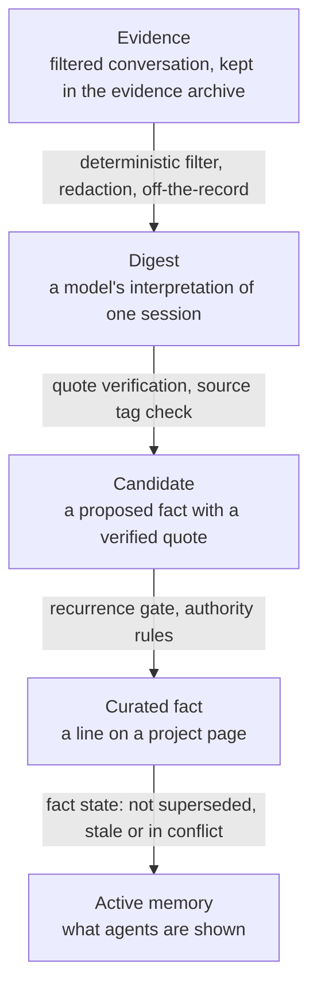
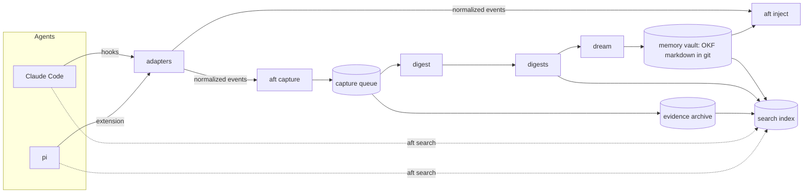

# Afterthought: design and build plan

Afterthought gives coding agents one shared, durable memory. Claude Code and pi are the
first two agents. Memory is a git repository of markdown pages you can read and edit in
Obsidian. Agents read it automatically at session start and search it on demand. A local
model builds it, slowly and carefully, from evidence in past sessions.

This is the design of record and the build plan, revision 3. It incorporates two peer
reviews of the design, two peer assessments of building afterthought versus adopting
akitaonrails/ai-memory or tigerless-labs/agent-memory, and your answers to the questions
those reviews left open.

## 1. The problem

Coding agents forget everything between sessions, and each agent keeps its own private,
unreliable notes. Existing memory systems fail in four recurring ways:

- **Agents do not use memory unless forced.** MCP tools go uncalled without explicit
  instructions, and skills get ignored. Anything that depends on the working model
  choosing to read or write memory is unreliable.
- **Consolidation cannot keep up.** Feeding whole transcripts to a memory model buries a
  local model or burns a hosted allowance. Most of a transcript is tool output.
- **Rewriting corrupts facts.** Models asked to keep memory tidy overwrite facts they
  should keep, and end up citing their own earlier rewrites instead of the sources.
- **Memory becomes a black box.** Vector stores and databases hold memory in a form you
  cannot read, correct or diff.

## 2. Goals and non-goals

**Goals**

- A cold session in either agent starts with the same short, relevant map of the project
  it is in, including where the last session left off, without being asked.
- Every session is captured without the agent doing anything, except what you mark as off
  the record.
- Memory stays readable, editable and diffable as markdown in git, in Open Knowledge
  Format (OKF) v0.2, openable as an Obsidian vault.
- One local model does all model work. Load stays bounded and degrades by queueing, never
  by dropping sessions.
- Changing an existing fact takes more evidence than adding one, and the evidence it takes
  depends on what kind of fact it is.
- Each consolidation run is one git commit plus a report, so any run can be reviewed and
  reverted.

**Non-goals for v1**

- Adapters for agents other than Claude Code and pi. The adapter boundary keeps adding one
  small, and other agents can use the `aft` CLI meanwhile.
- Teams, multiple users, a server, or syncing between machines. The memory repo can still
  be pushed to a private remote as a backup.
- Vector search, entity graphs, an MCP server, or a web UI.
- Replacing `AGENTS.md`. Instructions stay in `AGENTS.md`; memory holds facts.

## 3. Design principles

1. **Hooks, not goodwill.** Capture and injection run from agent lifecycle hooks. No part
   of the system depends on the working model deciding to use memory.
2. **The model interprets evidence; deterministic code controls state.** The model judges
   meaning: whether two facts are the same, whether a lesson is worth keeping. Code decides
   whether that judgment may change durable state, applies every edit, and commits. The
   model never writes a file.
3. **Files are the truth.** Every index is a cache that can be deleted and rebuilt from
   files without losing anything.
4. **Evidence travels with the claim.** Each fact carries a verbatim quote from its source,
   checked by a script, so a claim stays checkable after the original transcript is gone.
5. **Supersede, never silently delete.** Old facts are struck through and dated, and
   history stays in git. Deletion happens only when you ask for it.
6. **Small on purpose.** v1 is the smallest system that tests the thesis. A feature earns
   its place through a measured need.
7. **Self-contained.** Afterthought follows only its own rules and instructions. It never
   obeys what it imports: another tool's instruction file or index is read as evidence and
   checked like any other evidence. Imported sources are trusted only as far as you say
   (section 11).

## 4. The trust pipeline

Afterthought's central idea is that memory is trusted because it passed deterministic
checks, not because a model wrote it. Material moves through five stages, and each step
up has a guard:



- **Evidence is not memory.** It is what happened, kept so claims can be checked and
  digests regenerated.
- **A digest is not trusted memory.** It is an indexed interpretation of evidence. It is
  searchable, but nothing in it is asserted as true.
- **A candidate is a claim with verified evidence** that has not yet met the bar for its
  kind.
- **A curated fact is trusted because it passed the rules**, and it stays active until
  newer evidence with enough authority replaces it.

Curated facts are long-term or short-term memory (section 6). Long-term memory is what stays
true: it never ages, and a line leaves it only when newer evidence replaces it or you ask
`aft forget` to remove it. Short-term memory is what the project's last few sessions were
working with. It sits on its own page and rolls off as new sessions arrive, counted in
sessions and never in days, so a project left alone for a year comes back with its memory
whole.

## 5. Architecture

Four parts, with agent-specific adapters at the edge:



| Part | Runs when | Model? | Output |
|---|---|---|---|
| **Adapters** | Agent lifecycle events | No | Normalized events passed to `aft` |
| **Capture and digest** | Session end, compaction, and a sweep for missed sessions | Once per session chunk | Evidence in the archive, and a digest with a handoff note and candidate facts |
| **Dream** | Timer, after a project has been quiet | Once per candidate fact | Page edits, one commit, one report |
| **Recall** | Session start, and whenever an agent searches | No | An injected map, search results |

### The adapter boundary

Agent-specific code lives in two places only, so no Claude Code or pi assumption leaks
into the rest of afterthought:

- **Event adapters** turn each agent's hook payload into one normalized event:
  `session_start`, `compaction`, or `session_end`, carrying agent, session id, working
  directory, transcript path, and time.
- **Transcript readers** turn each agent's transcript format into normalized entries: id,
  time, role (you, assistant, tool), text, and tool errors.

Adding an agent means writing one adapter and one reader.

## 6. The memory vault

The vault is its own git repository and an Obsidian vault, separate from the code. What
you read lives in a visible directory, and the machinery lives in a hidden one:

| Location | Contents | Default |
|---|---|---|
| Vault | Curated pages, reference pages, digests, reports, and the library's files | `~/afterthought` |
| Home | `config.toml`, and state: evidence archive, search index, extracted library text, capture queue, cursors, locks, logs | `~/.afterthought` |
| Code | The `aft` package | Wherever it is installed |

Every setting lives in `~/.afterthought/config.toml`, including the vault's location
(`vault = "~/afterthought"`). The one thing the config file cannot hold is its own
location, so the `AFT_HOME` environment variable can point `aft` at a different home
directory. Normal use never sets it; the test suite uses it to run against temporary
directories without touching real memory.

Updating or switching branches of the code never touches memory, and backing up the vault
never includes runtime state.

```text
~/afterthought/
  index.md                 OKF bundle root (okf_version: "0.2"), generated
  log.md                   append-only history of runs
  registry.yaml            projects and the keys that resolve to them
  global/
    preferences.md         your preferences that apply everywhere
    environment.md         hosts, tools and services you use
  projects/<slug>/
    index.md               generated list of the project's pages
    overview.md            the main page
    recent.md              short-term memory: the last few sessions' working facts
  digests/<slug>/<yyyy>/<mm>/<date>-<agent>-<session>[-<n>].md
                           (digests/_unfiled/... for a session of no project)
  archive/<page path>      a page's resolved notes and superseded lines older than 90 days,
                           at the page's own vault path (archive/projects/<slug>/overview.md)
  references/<name>/       reference pages for one library collection (section 11)
  library/<name>/          the collection's source files, read-only after import
  reports/
    needs-you.md           generated: every open conflict and question
    <yyyy>/<mm>/<date>.md  one dream report per day, one section per run
  .obsidian/app.json       vault settings, with reports/ in Excluded files
```

Reports describe memory; they are never memory. `aft inject` never includes them, `aft
search` skips them unless asked with `--reports`, and the dream job never reads them, so a
run can never cite its own past decisions as evidence. The committed vault settings list
`reports/` under Obsidian's Excluded files, which keeps reports out of Obsidian's graph and
search while leaving them browsable in the file explorer.

### Kinds

A page's sections are the kinds of fact it holds, so every line's kind comes from its
heading and no line needs extra markup:

| Kind | Holds | Example |
|---|---|---|
| `preference` | What you want | "No RGB lighting." |
| `decision` | A choice and its reason | "The index is SQLite FTS5 because it needs no service." |
| `state` | How something is currently configured or running | "The model server runs vLLM on the GPU machine, port 8000." |
| `fact` | A durable truth about the project or its world | "The protocol's current field is offset-encoded, not two's complement." |
| `lesson` | What went wrong and what fixed it | "When the libolm build fails on ABI mismatch, pin version X." |
| `procedure` | How to do something | "Release by tagging on main after the gate passes." |
| `reference` | Where authoritative information lives and when to use it | "For message definitions use [[protocol-spec-2023]]; it replaces the 2016 edition." |

Candidates sit in their own section until they pass the gate.

### Page format

Every page is an OKF v0.2 concept file. Afterthought's own fields sit under one `aft` key,
which OKF consumers must tolerate and preserve.

```markdown
---
type: Project
title: afterthought
description: Shared memory for Claude Code and pi, kept as OKF markdown in git.
tags: [memory, agents]
sources:
  - id: s12
    resource: aft://session/claude/2c1e9d0a#entry-148
    title: Design session 2026-09-28
    quote: "Do you accept summaries written by a script at session end, instead of by the agent? Everything else depends on this. yes."
  - id: s31
    resource: aft://session/pi/01a0e256#entry-88
    title: Capture hook test
    quote: "capture.py: SessionEnd handler enqueued job in 12 ms"
generated: {by: "aft 0.1 / vllm example-model-8b", at: 2026-09-28T16:02:00Z}
status: stable
aft:
  project: p_01j9x4k2
  anchors:
    s31: {path: src/aft/capture.py, all_of: ["session_end", "enqueue"], commit: 4f2a91c}
---

## Decisions

- Capture summaries are written by a script at session end, not by the agent. [stated] 2026-09-28 [^s12]
- ~~Agents write their own summary each turn.~~ [suggested] 2026-09-26 [^s3] superseded 2026-09-28 by [^s12]

## State

- The capture hook enqueues work and returns without calling a model. [observed] 2026-09-30 [^s31]

> [!conflict] 2026-10-01
> A session says capture should also run on every compaction ([^s19]). The line above
> stands until stronger evidence arrives.

## Candidates

- Long orchestrator sessions need checkpoint capture. [inferred] 2026-09-30 [^s19] [^s20] (signals 2/3, sessions 1/2)
```

- **Sections:** a fact page's body is only `##` sections named for its kinds
  (`Preferences`, `Decisions`, `State`, `Facts`, `Lessons`, `Procedures`, `References`)
  plus `Candidates`. A reference page may also have a generated `Contents` section. There
  is no free prose: a page's one-line summary is its `description`, so every sentence an
  agent reads on a fact page is a fact with a source.
- **Line grammar:** `- <statement> [<source>] <date last evidenced> [^id] ...`, followed by
  any state marker. A candidate ends with its gate progress, `(signals a/b, sessions c/d)`, which the
  writer derives from the footnotes: one signal per source, one session per distinct session
  among them. The 30-day half weighting of R3 is applied by the gate, not written.
  Evidence counts (sources, sessions, last seen) are derived from the footnotes, so no
  confidence score is stored.
- **Project pages** name their project by id in `aft.project`, so renaming a project's slug
  changes no page.
- **Source tags** follow markdown-agent-memory: `[stated]` you asserted it in your own
  words, `[observed]` seen in a file, tool result or log, `[inferred]` the model's
  conclusion, `[suggested]` an idea or a musing nobody committed to. `[stated]` is an
  assertion: a fact, a choice, a preference, or a standing rule ("never push to main"). A
  request for the task at hand ("run the tests"), a question, and a tentative remark are not
  `[stated]`, and neither is text you pasted. A paste is not your own words: what it shows
  about the machine or the code (a log, an error, a command's output) is `[observed]`, and any
  other claim in it (a prompt, a document, another agent's message) is `[inferred]`, so it
  must recur before it is trusted.
- **Sources** use OKF's `sources` list, with an extra `quote` field holding the verbatim
  evidence and a `resource` URI naming the session and entry.
- **Anchors** tie a fact about code to a file, words that must appear in it, and the commit
  where that was verified (the repocodex pin check).
- **Every footnote resolves.** A `[^id]` anywhere on a fact page names a source in the
  page's `sources`, and every source a fact line cites carries a quote. Notes are read next to their fact,
  so an unresolvable citation there is as misleading as one on the line.
- **Text the tool did not write is never lost.** A person may type into a page, including
  answers under a note. The writer edits only what it can fully parse: an edit that would
  drop or rewrite text outside the grammar is refused and reported, and resolving a note
  moves the whole note, verbatim, to the archive instead of deleting it.

### Fact state

Where a fact came from and where it stands are separate. The parser reads state from the
markdown:

| State | Written as | Injected? |
|---|---|---|
| Candidate | A line in the Candidates section | No |
| Active | A plain line | Yes |
| Superseded | Struck through, with `superseded <date> by [^id]` | No |
| Conflict | Active line followed by a `[!conflict]` callout | Yes, with the conflict noted |
| Needs you | Active line followed by a `[!question]` callout | Yes, with the question noted |
| Stale | Line ending `(stale <date>: <reason>)` | No |
| Withdrawn | Struck through, with `withdrawn <date>` after `aft forget` | No |

### Short-term and long-term memory

Memory has two terms, short and long (st and lt where an abbreviation is needed). The
difference is what a fact is about, never how old it is.

- **Long-term memory** is every fact page except `recent.md`: what would still be true and
  useful the next time someone opens the project, even a year from now. Decisions and their
  reasons, preferences, how things are configured, lessons, procedures. A long-term line
  never ages. It leaves memory only when newer evidence supersedes it, an anchor marks it
  stale, or you withdraw it with `aft forget`.
- **Short-term memory** is `projects/<slug>/recent.md`: what is true now and matters for the
  next few sessions, but will change as the work moves on. Who is working on what, what is
  paused and why, a setting changed for a test. The page uses the same sections and line
  grammar as any fact page, has no Candidates section, and holds only `[stated]` and
  `[observed]` lines: a conclusion or an idea about the current work belongs in the session's
  handoff, not in memory.

What a session did and where it stopped (the task in progress, what was merged or run, what
comes next) is neither. It goes in the digest's summary and handoff (section 8), and
injection shows the newest handoff as the last session (section 10).

**Short term is counted in sessions.** A project's sessions are its primary sessions that
have a digest, in session order, whatever happened in them. A line on `recent.md` stays while
its newest source comes from one of the project's last `dream.short_term_sessions` sessions
(5 by default, at least 1). When a newer session pushes that source out of the window, the
line rolls off the page. A project with no new sessions keeps its short-term memory as it
was, however long it waits; injection shows the date of the newest session beside it, so
the reader can judge.

**Rolling off is not forgetting.** The line's evidence stays in its digest, the evidence
archive and git, and `aft search` still finds it there. Superseded and stale lines leave
`recent.md` the same way, when their newest source rolls out, rather than moving to
`archive/`. A note under a line that rolls off moves, verbatim, to the archive, as a resolved
note does, so an answer you typed there is never lost.

**A short-term line becomes long-term** in two ways:

- **It outlasts the window.** A line confirmed in session 1 and again in session 6 of a
  five-session window has stayed true through more than a full window, which is what
  long-term means. A line is promoted when the sessions of its oldest and newest sources
  are at least `short_term_sessions` apart.
- **A later session labels it long term.** A long-term fact from a digest that matches a
  line on `recent.md` promotes that line.

Promotion submits the line, with every source it has gathered, as a long-term fact to the
next decision (section 9), so it is checked against long-term memory like any new fact. The
line leaves `recent.md` whatever the decision, and a skip is reported. Recurrence alone does
not promote: three mentions within two sessions show the work is busy, not that the fact
will last. A promoted state that later changes is superseded by the newer evidence, as any
long-term state is.

You can manage the page by hand like any other: move a line to a long-term page to promote
it, or delete it to drop it. A line you add to `recent.md` counts as a source from the
project's newest session at the time of the edit.

## 7. Project identity

A working directory resolves to one project:

1. Resolve symlinks, and resolve a linked git worktree to its main checkout.
2. Look up `host:path` in `registry.yaml`. The longest matching path prefix wins, so a
   repository nested inside another resolves to the inner one. Submodules resolve to
   themselves.
3. Otherwise look up the normalized `origin` remote. A match records the new path as an
   alias, so a moved or re-cloned repository keeps its memory.
4. Otherwise, inside a git repository, the directory is an unregistered project named after
   its directory. It is added to the registry only when its first curated fact is written,
   so a throwaway directory creates nothing.

A session's project is decided when the session starts, while its directory exists: the
session-start hook resolves the directory to build the memory block, and records the answer
beside the capture queue. A worktree is often removed before its session is digested, and
the digest then files the session under the recorded project. When `capture.exclude_projects`
names any project, a session with no record whose directory is gone is dropped, because it
cannot be shown to be outside the exclusion.

A session that belongs to no project, because its directory is outside every registered
project and every repository or is gone with no record, is still captured. It is archived
and indexed under no project and digested as unfiled, under `digests/_unfiled/`. Dreaming
takes only its global facts into memory, under the usual rules: what you say about yourself
and your machines counts wherever you say it. Its project facts have no project page, so
they stay in the digest, where `aft search --all` finds them, and the report lists them.
Nothing is made a project automatically, so a session in `~/Downloads` never creates one;
`aft project add` registers a directory, git or not, that should be one.

Each project has a stable id separate from its slug, so a rename rewrites nothing else.
`aft project list`, `aft project rename` and `aft project forget` manage the registry.
Global facts apply in every project. The digest keeps every verified fact with its scope.
Dreaming files a global `[stated]` fact on `global/preferences.md` when it is a preference
and on `global/environment.md` for every other kind; a global fact that is not `[stated]`
is skipped and reported (R6).

## 8. Capture and digest

### Adapters in v1

| Agent | Session start | Capture |
|---|---|---|
| Claude Code | `SessionStart` hook, including after `/clear` and compaction | `SessionEnd` and `PreCompact` hooks |
| pi | Extension on `session_start` | Extension on `session_shutdown` and compaction |

Exact payloads and pi extension events are verified against the installed versions in M1.

### The capture queue

A capture hook writes one row to a SQLite queue in a transaction and exits, in under
50 ms. It never calls a model and always exits successfully, so a failure never affects
the agent. Claude Code and pi finishing at the same moment cannot corrupt each other's
watermarks. A sweep on the timer finds sessions whose hooks never fired, and running
sessions that are idle or large, so long-lived sessions are processed in chunks.

### The filter

A deterministic filter turns each transcript chunk into evidence:

- keep your prompts and the assistant's final text; drop thinking and tool output
- from tool output, keep only error and failure lines and `file:line` references
- cap each message at about 1,500 characters
- drop anything you marked off the record (section 12)
- redact secrets (keys, tokens, private keys, credentials in URLs) and your own patterns
- skip sessions with fewer than two prompts, and excluded paths
- drop any line that repeats the project's memory block, which the session was given at
  start: memory reflected back is not new evidence, and counting it would confirm memory
  with its own echo

Measured on this host over 30 days, this takes Claude Code transcripts from 500 MB to
13.8 MB, and the interactive sessions that matter to about 6.4 MB: roughly 55,000 tokens a
day. Removing common words and punctuation would save about 12% more and risks changing
meaning ("do not use X" becoming "use X"), so the filter keeps text intact.

### The evidence archive

Filtered conversation is stored compressed in the home directory, outside git. It gives
search and `aft trace` one uniform record of both agents' sessions, independent of each
agent's own cleanup (Claude Code on this host keeps 90 days; pi sets no limit), and it lets
`aft redigest` regenerate recent digests when the prompts improve. Its job is short-term: the memories themselves are the digests and curated
pages, which keep their verbatim quotes permanently. Filtered conversation is therefore
purged after 90 days by default, configurable in `config.toml`. The archive is evidence,
never memory: nothing in it is injected.

### Worker sessions

Sessions under configured worker paths (orchestrator worktrees, validation gates) are
evidence of a lower rank. Their filtered text goes into the archive and the search index,
which costs no model time, so an error like a failed test run stays findable. They are
digested only when the day's model budget has room, and a fact from a worker session stays
a candidate until a primary session corroborates it. Worker evidence never confirms a
standing line either: a `confirm` from a worker session is skipped and reported, so it
adds no source and no date.

### The digest

One model call per chunk returns JSON, constrained by a schema through the endpoint's
structured output:

```json
{
  "summary": "1-4 sentences on what happened",
  "handoff": {
    "in_flight": {"text": "what was being worked on when the session ended", "entry": "#41"},
    "failed": [{"text": "an approach tried that did not work", "entry": "#17"}],
    "open": [{"text": "a question or next step left open", "entry": "#40"}]
  },
  "facts": [
    {
      "statement": "Capture runs at session end, not per turn.",
      "kind": "decision",
      "source": "stated",
      "term": "long",
      "quote": "exact words copied from the transcript",
      "entry": "#12",
      "scope": "project",
      "anchors": []
    }
  ]
}
```

The prompt asks only for facts a future session could not get from the code or git
history, and for what was decided, surprising, or learned the hard way. It tags tentative
statements ("I think I'll switch to SGLang") as `[suggested]`, and requests, questions and
pasted text as section 6 describes, never as `[stated]`. What the session did and where it
stopped goes in the summary and handoff, not in facts. Each fact carries a term: `long` when
it would still be true and useful the next time someone opens the project, even a year from
now, and `short` when it is true now but will change as the work moves on. When the model is
unsure it says `short`, the cheaper mistake: a short-term line that keeps holding is promoted,
while a wrong long-term line stays until something replaces it.

A summary and a handoff carry no quote, so they are trusted only as far as the answer they
came in matches its chunk. The chunk is at most 12,000 tokens, counted at three characters
to a token so the estimate errs high: a small model given more loses track of it. Each
entry is shown under a short label (`#1`, `#2`), which every fact and every handoff item
names, and the script maps the label back to the entry's own id; the label's number
without its `#`, and an entry's id copied exactly, are accepted too. An answer with a fact citing an entry the chunk does not hold, an
empty summary, fact statement or quote, a placeholder (written text with no word in it,
such as `...`) where a summary, a handoff item or a fact should be, or two or more facts
none of whose quotes is in the entry it cites, is about something other than the chunk: it is asked for once more. A part answered that way twice gives the
page nothing, neither summary, handoff nor fact, and the page records it under
`aft.refused_parts` with its first and last entry and the reason; the job's other parts are
kept, so one part the model cannot read does not lose a long session, and `aft redigest`
can read the part again later. When the last part is refused, the handoff is empty, since
nothing says where the work stood at the end. A job whose every part is refused fails,
leaving its entries to be read again.  The script then:

- drops a handoff item whose entry is not one of the chunk's
- drops any fact whose quote does not appear in the cited entry (whitespace-normalized)
- drops `[stated]` unless the cited entry is one of your turns
- drops a short-term fact that is `[inferred]` or `[suggested]`, or whose scope is global:
  short-term memory holds only what you said or a session saw, and only for a project
- writes the digest as an OKF file (`type: Session Digest`) under `digests/`: one page
  per job. The first job for a session on a day writes `<date>-<agent>-<session>.md`, and
  later jobs that day add `-2`, `-3` before `.md`. A digest's content changes only when
  you ask: `aft redigest <session>` replaces a session's digest pages with ones rebuilt from
  the archive (applying the current redaction patterns and counting against the daily
  budget), and `aft forget` scrubs them. Otherwise dreaming only marks a digest consumed, so
  each page is dreamed once, in session order. The consumed mark holds the dream run's id,
  which the run's commit message also names, so `git log --grep <run id>` finds the commit. A rebuilt digest is unconsumed and is dreamed
  again; a fact it repeats confirms rather than duplicates. The replaced pages stay in the
  vault's git history.

## 9. Dreaming

Dreaming turns digests into curated facts. It runs from a systemd user timer every 30
minutes (configurable), and capture can start it early. A run exits immediately when no
digests are waiting. It works one project at a time, only after that project has been
quiet for 15 minutes (configurable), holds a lock, and processes digests in session order
so later evidence is applied after earlier evidence.

### A run

1. **Check for hand edits.** If the vault has uncommitted changes made within the quiet
   period, skip this project for now; you may still be editing. Older uncommitted changes
   are committed first as a separate `checkpoint: human edits` commit, and lines you added
   are tagged `[stated]`.
2. For each candidate fact, find related lines on the project's pages, `recent.md`
   included, with a keyword search.
3. Ask the model for one decision per candidate, as JSON:

| Decision | Meaning |
|---|---|
| `add` | A new fact. Add a line under its kind. |
| `confirm` | Already known. Add the new source and date, and count it toward recurrence. |
| `supersede` | Replaces an existing line, which is struck through, dated and linked. |
| `conflict` | Contradicts an existing line without the authority to replace it. |
| `skip` | Routine, re-derivable from code or git, too vague to act on, or, for a long-term fact, not durable. |

A short-term fact goes only to `recent.md`. Its `add` adds a line there; its `confirm`
adds the source to the line it names, on `recent.md` or a long-term page; its
`supersede` or `conflict` applies only to a line on `recent.md`, and against a long-term
line it becomes an `add` on `recent.md`, so a passing state never edits long-term memory.
A long-term fact whose `confirm` names a line on `recent.md` promotes that line
(section 6).

4. Check every decision against the rules. A decision that fails is downgraded (a refused
   `supersede` becomes `conflict` or needs you) or rejected, and the reason goes in the
   report.
5. Apply the surviving edits with the script, never the model.
6. Run maintenance: anchor checks, moving superseded lines older than 90 days on long-term
   pages to the archive, and flagging pages over their size cap. On `recent.md`, promote each
   line whose sources are at least `dream.short_term_sessions` sessions apart through steps 3
   to 5, then remove every line whose newest source has left the project's last
   `short_term_sessions` sessions.
7. Regenerate each `index.md`, append to `log.md`, lint every page, and make one commit.
8. Write the report.

### The rules

| Rule | What it enforces | Checked by |
|---|---|---|
| **R1 Provenance** | Every fact line carries one source tag and at least one source with a verified quote. | Script |
| **R2 Stated means you asserted it** | `[stated]` requires a quote from one of your turns (or your own edit) that the digest judged an assertion in your own words: not tentative, not a request for the task at hand, not a question, and not text you pasted (section 6). | Script, model |
| **R3 Recurrence gate** | An `[inferred]` or `[suggested]` fact needs 3 or more signals across 2 or more primary sessions before it leaves Candidates. Signals older than 30 days count half. An explicit correction from you skips the gate. Lessons are stored as facts ("when X broke, Y fixed it"), never as instructions. | Script counts, model matches |
| **R4 Authority by kind** | Replacing a line needs a verified quote newer than the line's latest evidence, and the authority the table below gives. Without it the result is a conflict, and the old line stands. | Script |
| **R5 Only what cannot be re-derived** | No file listings, code excerpts over a few lines, or anything git already records. Prefer durable phrasing over figures that go stale. | Model, then script heuristics |
| **R6 One project per unit of work** | A run never edits another project's pages. Global pages change only from `[stated]` facts. | Script |
| **R7 Size caps** | Pages over their cap are flagged in the report. Condensing and splitting come after v1. | Script |
| **R8 Anchors** | An anchored fact whose words no longer appear in its file on the default branch is marked stale, not deleted. When the words appear again, the check clears the stale mark and reports it; the line keeps its date, since matching words are not a verified quote. A line with an open conflict or question keeps its note, and a broken anchor is only reported until the note is closed; a question to you is never closed automatically. Anchors verified on an unmerged branch are not checked until that commit reaches the default branch. | Script (ripgrep, git) |
| **R9 No free-form writes** | Model output is schema-constrained JSON. Only the script edits files. | Script |
| **R10 Short term stays short** | A short-term fact edits only `recent.md`, except to confirm a long-term line. A line leaves `recent.md` when its newest source leaves the project's last `dream.short_term_sessions` sessions, and becomes long-term only when its sources are that many sessions apart or a later session's long-term fact confirms it. Nothing in memory ages by time. | Script |

### Authority to replace a fact

`[inferred]` and `[suggested]` never replace anything. An explicit correction from you
replaces anything. Otherwise:

| Kind | Replaced automatically by | When only weaker evidence disagrees |
|---|---|---|
| `preference` | Your newer `[stated]` | Conflict. If `[observed]` evidence contradicts it, the line needs you. |
| `decision` | Your newer `[stated]` | Same as preference. |
| `state` | Newer `[observed]` or `[stated]` | Conflict. Replacing one of your statements is listed in the report. |
| `fact` | Newer `[observed]` or `[stated]` | Same as state. |
| `lesson` | Newer `[observed]` or `[stated]` | Conflict. |
| `procedure` | Newer `[observed]` or `[stated]` | Conflict. |
| `reference` | Newer `[observed]` or `[stated]` | Conflict. |

Your statement about what you want or chose stays authoritative until you change it. What
a later session actually observes about the machine or the code outranks an older claim.
The quote check stands in for a second model: a claim is only as strong as the words a
script can find in its source.

### The report

Each day has one report file, `reports/<yyyy>/<mm>/<date>.md` (`type: Dream Report`), and
each run that changes anything appends one section to it. A busy day with many runs is
still one file, and each run is still its own commit, so it can be reverted on its own.
Reports are kept forever: at a few kilobytes a day they add up to about a megabyte a year.
Git holds the exact diff of every run, and the report holds why each change was made.

Each run's section has a fixed format from the first release, so reports stay comparable
over time:

1. **Summary**: counts per decision, tokens used, digests processed, backlog remaining
2. **Needs you**: lines waiting on your decision
3. **Superseded**: old line, new line, the quote that justified it
4. **Added** and **Confirmed**: each with its quote
5. **Conflicts**: both claims and their evidence
6. **Rejected**: what the model proposed and the rule that refused it
7. **Stale**: facts whose anchors stopped matching
8. **Candidates**: progress toward the gate
9. **Short term**: lines added to `recent.md`, promoted from it, and rolled off it
10. **Revert**: `git revert <sha>`, and the separate checkpoint commit if one was made

Every run also regenerates `reports/needs-you.md`: one list of every open conflict and
question across all projects, each linking to its line and to the report section that
raised it. It is the one page to check, and it is worth bookmarking in Obsidian.

## 10. Recall

### Injection at session start

`aft inject` reads files only, uses no model, and targets under 150 ms. The block acts as
a map of the project, not a dump of it. It is capped at about 8,000 characters (roughly
2,000 tokens) to start, built in this order:

1. the project name and its one-line description
2. **last session**: in flight, what failed, and what is open, from the newest digest
3. the project's active state, decisions and lessons, with conflicts and questions noted
4. your global preferences
5. **recent**: the active lines on `recent.md`, headed with the number of sessions they cover
   and the date of the newest
6. one line per other page from the project's `index.md`, and one line per reference page
   linked to the project
7. two lines on how to search and read

Short-term memory comes after long-term memory, so it never crowds out what stays true when
the block reaches its cap. Candidates, stale, superseded and withdrawn lines, and dream
reports are left out, and nothing is injected per tool call. agentmemory found that
injecting context into every tool turn burned tokens and turned it off by default. The cap is a starting point; M5 tunes it by usefulness.

### Search

`aft search` queries a SQLite FTS5 index with BM25 ranking. The default collections are:

| Collection | Contents |
|---|---|
| Pages | Active curated lines, with titles and descriptions weighted above body text |
| Digests | Session summaries, handoff notes and candidate facts |
| Evidence | Filtered conversation from the evidence archive |
| Library | Text extracted from library files, chunked by page or section |

Lines that are out of memory (superseded and stale lines, whether still on their page or
moved to `archive/`, and resolved notes with the fact they belonged to) are searched only
with `--archive`, and dream reports only with `--reports`, so old history and records about
memory do not crowd out memory itself. Withdrawn lines are never searched.
Results come back as paths with their collection and section (a library result names its
page or section), a one-line description and the matching snippet. `aft read <path> --level outline|abstract|full` opens a result at the
depth a task needs, and `aft trace <source>` shows a fact's quote and the evidence around
it. `aft reindex` rebuilds the index from files, and a test proves the rebuild matches.

## 11. The library

Some knowledge is not remembered from sessions but imported: specifications and
standards, datasheets, manuals, vendor documentation, and working notes. The library
holds those sources, and memory holds a detailed, verified map of them, so an agent knows
what exists, where it is, and when to use it.

Two rules shape it:

- **The library holds sources; memory holds knowledge.** Source files are read-only once
  imported. What is learned about them, and anything that changes over time, lives in
  memory as curated facts under the normal rules.
- **Imported sources are trusted as far as you say, and never obeyed.** You declare each
  collection's authority when it is imported (below). An existing index, table of
  contents, or instruction file inside a collection is always evidence to check, never a
  map or a rule to follow, whatever the collection's authority: it may be out of date or
  wrong, and nothing says what produced it.

### Collections

The unit of the library is a collection: a set of related files imported together, such
as everything about one protocol standard. A collection's files are copied into `library/<name>/`, keeping
their relative layout. The library never points at files outside the vault, because
nothing stops them being moved, renamed or deleted later. The original location is
recorded only as history.

Each file in a collection has one role:

| Role | Meaning | Example |
|---|---|---|
| `original` | A source document | A protocol specification PDF |
| `derived` | A version made from another file, such as cleaned text or extracted tables | A cleaned markdown rendering of the specification |
| `errata` | Corrections to another file, which win where the two conflict | A list of known specification errors |
| `notes` | Working notes: kept as sources, and mined for facts | Notes on an undocumented device |
| `exclude` | Not imported | Build scripts, generated indexes, git history, `AGENTS.md`, `CLAUDE.md` |

Relations between files are recorded explicitly: `derived-from`, `errata-for`, and
`supersedes` (a newer edition replacing an older one). They are shown on the reference
pages and drive search: derived text is indexed in place of its original, so one passage
is not returned twice. After v1 they will also drive authority (errata winning over the
document they correct, a newer edition over the one it supersedes).

### Authority

Each collection has an authority, which you declare when it is imported. The import skill
asks you; the agent never chooses it on its own. It is recorded in the manifest and in the
import commit, so it can be reviewed and changed by importing again.

| Authority | Meaning | Example | Facts from its `original`, `derived` and `errata` files |
|---|---|---|---|
| `authoritative` | You accept it as the governing source for what it covers | A standard your project implements | Enter as `[observed]` |
| `reference` (default) | Useful, but not settled truth | Vendor application notes, a forum write-up | Enter as `[inferred]` or `[suggested]`, so they wait as candidates |

Whatever the collection's authority:

- Facts from `notes` files, and from excluded instruction files, enter as `[inferred]` or
  `[suggested]`.
- Nothing imported is `[stated]`. That tag means you committed to something in your own
  words (R2), and a document is not your words; declaring it authoritative is what gives
  it weight.
- Facts from an authoritative source follow R4 like any `[observed]` fact: they never
  replace a `preference` or `decision` you stated, and a contradiction becomes `needs you`.

### An agent runs the import

Importing takes judgment that a single command cannot make: which files are originals,
which are derived, which are notes, and how they relate. An agent makes those judgments
because you ask it to ("add this protocol documentation to the library"), and deterministic
commands check and carry out its plan. The agent never writes into the library itself.

1. **`aft library survey <path>`** changes nothing. It lists every file with its type,
   size and hash, flags duplicates, suggests likely derived pairs (the same name with a
   different extension), and prints the import procedure. The procedure travels with the
   command, so an agent that has not loaded the skill still gets it.
2. **The agent writes a manifest**: the collection's name and description, the projects it
   applies to, the authority you gave, one role for every file, and the relations between
   files.
3. **`aft library import <manifest>`** validates the manifest before touching anything:
   every surveyed file has exactly one role, every relation points at a file in the
   collection, and no instruction file or tooling is kept. It then copies the files,
   extracts their text into the home directory keyed by content hash, indexes it, and
   generates the structure of the reference pages from the files themselves.
4. **The agent adds descriptions** with `aft library describe <manifest> <descriptions>`:
   what each document is, its version or date, and when to use it and when not to. Every
   claim carries a quote, which the command checks against the document's extracted text
   before it writes the description onto the reference page. A claim that fails is listed in
   the report and not written. The agent never edits a reference page itself.
5. **The agent proposes facts** from the collection's documents, notes and excluded
   instruction files. Each is quote-checked against its file and enters the dream as a
   digest, tagged by the collection's authority (above), under the same rules as facts
   from sessions. An excluded file is not kept, so its facts record that the
   quote was verified at import and that the original was not retained.
6. The import ends with a report, in the same format as a dream report, and one commit.

Afterthought ships the import procedure as a skill, installed for Claude Code and pi by
their adapters. The skill only drives these commands, so the procedure lives in one place.

### The map is generated and verified

Afterthought builds every map from the files: the file list, headings, page counts, and
the keys of structured data (every message type in a definitions file, for example). A map that came
with the collection, such as a README table or a JSON index, is only evidence. Each claim
taken from it is checked: the path exists, the heading or key exists, and any description
quoted from it appears in the document it describes. Claims that fail are listed in the
import report and never used.

### Reference pages

Each collection has a folder of OKF pages, `references/<name>/`. OKF reserves `index.md`
for directory listings, so the collection's own page is `collection.md`:

- `collection.md` (`type: Reference`): what the collection covers, its main documents, the
  projects it applies to (in `aft.projects`), and the generated contents map
- one page for each major document: its relations and a generated map of its sections with
  page numbers, plus the verified descriptions from step 4 (what it is, its version or date,
  when to use it). A fixed template for these pages comes after v1.

Obsidian opens PDFs, so a reference page can link straight to a page of the source, such
as `[[protocol-spec-2023.pdf#page=112]]`. Injection shows one line per collection in the
projects it applies to. Agents open reference pages with `aft read` and search the
collection's text with `aft search`. Facts learned in sessions about a source ("the
message table on page 112 has a known error") are ordinary curated facts on its reference page.

### Indexing

The Library search collection indexes documents only: PDF, markdown, text and HTML, split
by page or heading, with each result naming its document and section. Derived text is
indexed in place of its original. Large structured files such as JSON are split by
top-level key, so a lookup lands on the right entry. Images and binaries are kept but not
indexed.

### Changes after import

Sources do not change. A new edition is a new import whose files `supersede` the old
ones, and the old reference pages are marked superseded under the normal rules. `aft lint`
checks every library file against its recorded hash, so an edited or deleted source is
caught.

### Storage

By default, library files are committed to the vault's git repository like everything
else, so the vault is complete and backs up as one unit. `library.commit = false` in
`config.toml` keeps them out of git instead, through the vault's `.gitignore`. Two
consequences follow from committing them:

- The vault's repository must stay private. Imported documents can carry third-party
  copyright, so the vault must never be pushed to a public remote.
- Large binaries make the repository grow with every version of a file, since git keeps
  them all. A library of a few hundred megabytes is fine; a much larger one is a reason to
  set `library.commit = false`.

## 12. Forgetting and privacy

Capture is automatic, so not capturing has to be deliberate and deterministic:

- **Off the record.** A prompt that begins with `aft off` or `off the record` starts an
  off-the-record span, and one that begins with `aft on` or `on the record` ends it. Case
  and trailing punctuation do not matter, and an unclosed span runs to the end of the
  session. The markers count only at the start of a prompt, so discussing them mid-sentence
  never triggers them. The filter drops the span before anything is archived, indexed or
  sent to the model.
- **Exclusions.** Paths and projects listed in `~/.afterthought/config.toml` are never
  captured.
- **Redaction.** Built-in secret patterns plus your own patterns, applied before archiving.
- **`aft forget session <id>`** removes the session from the evidence archive, the capture
  queue, the index and the digests, withdraws curated lines that rested only on it, and
  scrubs its quotes wherever afterthought copied them: page sources, reports and
  `needs-you.md`.
- **`aft forget pattern <regex>`** replaces matching text with `[redacted]` in the archive
  and everywhere afterthought copied it (digest quotes, page sources and statements, reports),
  updates the index to match, and prints the line that adds the pattern to future redaction.
  Quotes stay verifiable because the archive holds the same redaction.

Forgetting removes content from everything afterthought controls. The vault's git history
still holds older commits; removing them means rewriting history, which `aft forget`
explains how to do but never does on its own.

## 13. The model and its load

- One OpenAI-compatible endpoint, set in `~/.afterthought/config.toml`, such as a local vLLM
  server with an open-weight model. A hosted endpoint works the same way. What one endpoint
  needs and another does not, such as telling a reasoning model not to think, goes in the
  optional `model.extra_body` table, whose fields are added to every request; it cannot
  override the fields aft sets itself. An endpoint that
  needs an API key, local or hosted, gets it from an environment variable: `config.toml` names
  the variable in `model.api_key_env`, never the key itself, and the key is sent as a bearer
  token. An endpoint without a key needs neither. The key never appears in logs, reports or
  error messages.
- Afterthought calls the endpoint over HTTP. It never runs an agent harness from inside a
  hook, which avoids a loop where memory work creates sessions to capture.
- Budgets: a per-chunk input cap for digests, a per-run token budget for dreaming, and a
  daily cap. When a budget runs out, work waits in the queue and the report shows the
  backlog. Worker digests only use budget left over.
- Expected load at today's volume is about 55,000 input tokens a day for digests plus a
  smaller amount for dreaming.

## 14. Failure handling

| Failure | Behavior |
|---|---|
| A hook errors or times out | The agent session is unaffected. The sweep finds the session later. |
| Two agents finish at once | Queue writes are transactional; neither loses its watermark. |
| The model endpoint is down | Jobs stay queued. Nothing is lost. |
| The model returns malformed output | Schema-constrained decoding prevents it; a response that still fails validation is retried once, then left queued and reported. |
| A dream run makes a bad edit | `git revert` the run's commit. The report names it. |
| You are mid-edit in Obsidian | Dreaming skips that project until the quiet period passes. |
| The index is corrupt | `aft reindex` rebuilds it from files. |
| A transcript or its archived evidence expires | Digests and pages keep their verbatim quotes; `aft trace` shows the quote and says the full context is gone. |
| A library file is edited or deleted | `aft lint` reports the hash mismatch; restore it from git or re-import the collection. |

## 15. Build plan

v1 is the smallest system that tests the thesis: evidence-backed consolidation, simple
retrieval and injection are enough to give agents useful memory. Each milestone ends with
a runnable check. Every change ships behavior or a test. Reviews look at code and
behavior, and this document changes only when a design decision changes.

| Milestone | Delivers | Done when |
|---|---|---|
| **M0 Skeleton** | Python package and `aft` CLI, `~/.afterthought/config.toml`, paths, vault initialization, registry with stable ids, `aft key`, `aft project`, `aft lint` (required OKF fields, line grammar, fact state) | Key tests pass for a nested repo, a linked worktree, a symlinked path, a submodule, a repo with no remote, and a re-clone found by remote. Lint accepts valid pages and rejects each kind of broken one. |
| **M1 Recall** | Adapter boundary, `aft inject`, the Claude Code hook, the pi extension, hand-written pages for afterthought | A cold session in each agent receives the same block, under the cap, in under 150 ms. |
| **M2 Capture** | Capture queue, sweep, transcript readers, filter with off-the-record and redaction, evidence archive, worker classification, digest through the model endpoint with handoff, `aft forget`, `aft redigest` | Scripted sessions in both agents produce digests whose quotes all verify. A rerun adds nothing. An off-the-record span and planted secrets never reach the archive, the index or the model. Capture returns in under 50 ms. Evidence older than the retention window is purged. |
| **M3 Search** | FTS5 over pages, digests and evidence; `aft search`, `aft read`, `aft trace`, `aft reindex` | Known-answer queries return the expected file in the top five. A rebuilt index matches the original. |
| **M4 Dream** | Timer, quiet period, lock, hand-edit checkpoint, decisions, rules R1 to R10 with the authority table, daily report, `needs-you.md`, vault settings, commit | A fixture suite covers: no-op run makes no commit; add; confirm; allowed supersede for each kind; refused supersede becomes conflict or needs you; tentative statement stays suggested; inferred fact stays a candidate below the gate; worker-only fact stays a candidate; cross-project edit refused; bad quote rejected; broken anchor marked stale; mid-edit project skipped; older hand edit checkpointed; a second run on the same day appends to that day's report; reports never reach injection, default search, or the dream's own input; a short-term fact lands on `recent.md` and never edits a long-term line except to confirm it; a short-term line rolls off after the configured number of sessions and stays put while no sessions arrive; a line whose sources span the window is promoted, and one confirmed three times in two sessions is not. |
| **M5 Use and evaluate** | Two weeks on afterthought plus one real project; `aft eval` over a golden set you write | The golden set passes positive and negative cases: expected memory found, irrelevant memory not injected, a known fact survives contradicting noise, and an attractive weak inference is not promoted. You find the injected map useful, and reports show no corrupted facts. |
| **M6 Switch-over** | Import Claude Code's `MEMORY.md` files as `[inferred]` digests; turn off Claude Code's automatic memory; add a short memory section to `~/AGENTS.md` | Afterthought is the only memory the agents use. |
| **M7 Library** | `aft library survey` and `aft library import`, the manifest validator, file roles and relations, text extraction, the generated map with verification of imported maps, reference pages, the import skill, the Library search collection, the `library.commit` setting, collection authority; import two real documentation collections | Both collections import with every file accounted for, every reference quote verified, and no instruction file, tooling or git history retained. A claim planted in an imported index that does not match its document is rejected. Facts from an authoritative collection enter as `[observed]` and from a reference collection as candidates. Known-answer queries about a specification return the right document and page. |

Performance and accuracy come before line count: the size of `src/` is measured and reported,
not a target.

**After v1, only when M5 shows the need:** link suggestions and aliases written by the
dream; condensing and splitting pages over their cap; an HTML rendering of reports and a
dashboard; recall on each prompt and before an edit; vector search on the CPU; more
adapters; an MCP server; syncing between machines.
